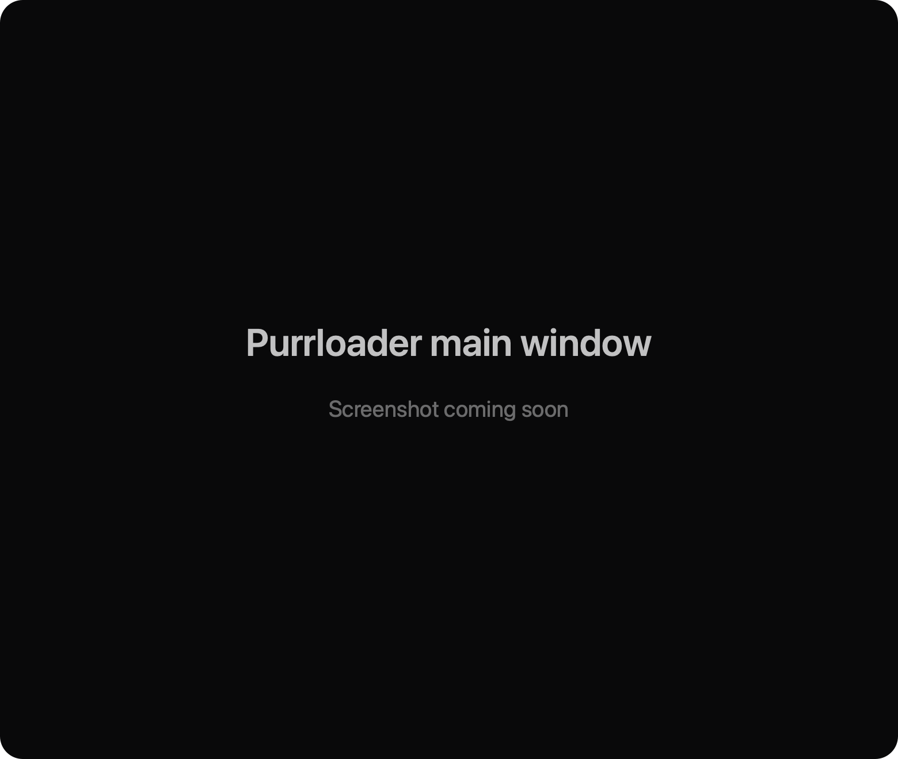
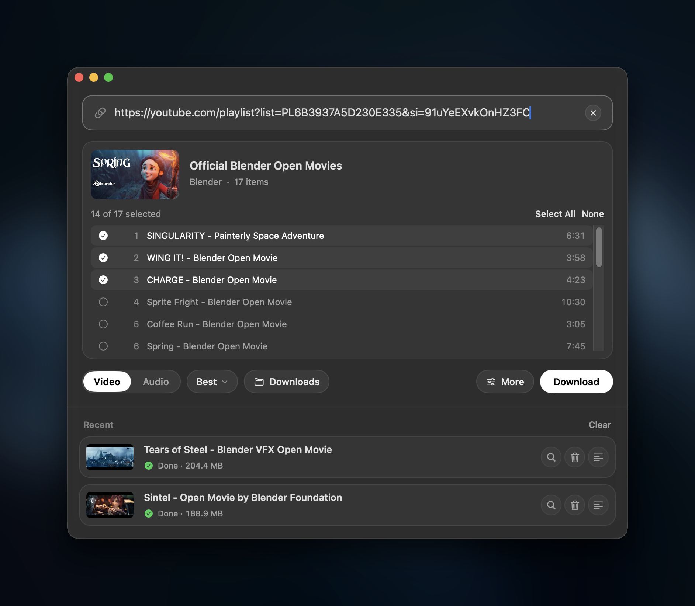
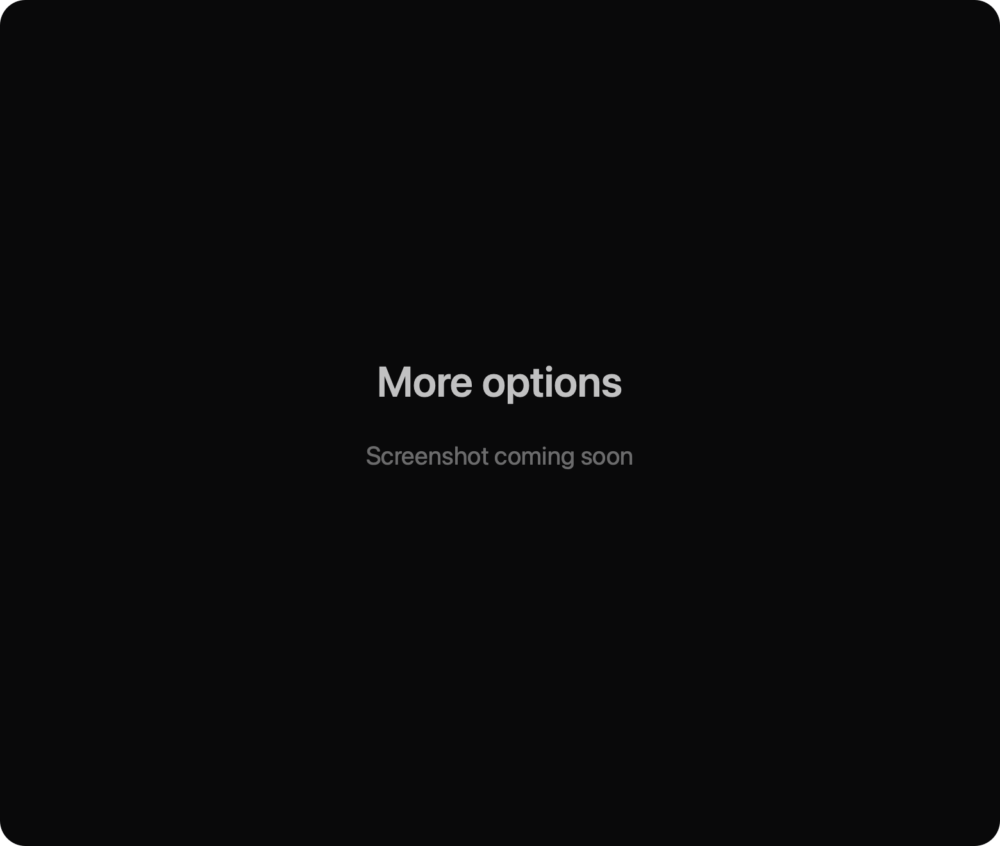

<div align="center">


# Purrloader

**Save videos and audio from the web.**

[](#macos)
[](#windows)
[](#linux)
[](LICENSE)
[](https://github.com/BLCNYY/Purrloader/releases/latest)

### Download for [Mac](https://github.com/BLCNYY/Purrloader/releases/latest/download/Purrloader.dmg) · [Windows](https://github.com/BLCNYY/Purrloader/releases/latest/download/Purrloader-Setup-x64.exe) · [Linux](#linux)

Free and open source. No account, ads or tracking.

<br>



</div>

## Features

- Video (MP4) or audio (MP3, M4A or lossless)
- Playlists, with a checklist to pick videos
- Pause and resume, even after quitting
- Subtitles, sponsor skipping (SponsorBlock) and downloading part of a video
- Private and age-restricted videos, using your browser's sign-in
- Progress in the menu bar or system tray
- Light and dark mode
- Thousands of sites, through [yt-dlp](https://github.com/yt-dlp/yt-dlp)

Downloads go straight from the site to your computer. On first launch Purrloader downloads its helper tools
(yt-dlp, FFmpeg and Deno, about 150–240 MB) and checks each against its publisher's checksum.

## Install

### macOS

[Download Purrloader.dmg](https://github.com/BLCNYY/Purrloader/releases/latest/download/Purrloader.dmg), open it and
drag Purrloader into Applications. Needs macOS 15 or later, on Apple Silicon or Intel.

### Windows

Download [Purrloader-Setup-x64.exe](https://github.com/BLCNYY/Purrloader/releases/latest/download/Purrloader-Setup-x64.exe),
or [Purrloader-Setup-arm64.exe](https://github.com/BLCNYY/Purrloader/releases/latest/download/Purrloader-Setup-arm64.exe)
for Windows on Arm (Qualcomm Snapdragon X Series and Nvidia RTX Spark). Not sure which? See Settings > System > About >
System type. It installs for your account without admin rights. Needs Windows 10 or 11.

The installer isn't code-signed yet, so Windows may say "Windows protected your PC". Click **More info**, then
**Run anyway**.

### Linux

Debian, Ubuntu and their derivatives:

```bash
wget https://github.com/BLCNYY/Purrloader/releases/latest/download/purrloader_amd64.deb
sudo apt install ./purrloader_amd64.deb
```

Other distributions:

```bash
wget https://github.com/BLCNYY/Purrloader/releases/latest/download/Purrloader-x86_64.AppImage
chmod +x Purrloader-x86_64.AppImage
./Purrloader-x86_64.AppImage
```

If the AppImage doesn't open, install FUSE (`sudo apt install fuse3`) or run it with `--appimage-extract-and-run`.
There's also a [plain archive](https://github.com/BLCNYY/Purrloader/releases/latest/download/Purrloader-linux-x64.tar.gz),
and every file comes in an arm64 version on the [releases page](https://github.com/BLCNYY/Purrloader/releases/latest).

Needs glibc 2.35 or later (Ubuntu 22.04 or newer) and OpenGL 3.3. On GNOME, the tray icon needs the AppIndicator
extension.

## Usage

1. Copy a link. Purrloader picks it up from the clipboard, or paste or drop it on the window.
2. Choose Video or Audio, and a quality if you like.
3. Press Download. Files go to your Downloads folder unless you pick another with the folder button.

Subtitles, sponsor skipping and partial downloads are under **More**. Everything else is in Settings > Advanced.
On Windows and Linux, Settings and History are in the ☰ menu.

<div align="center">


</div>

## FAQ

<details>
<summary><b>Which sites work?</b></summary>

Most sites [yt-dlp supports](https://github.com/yt-dlp/yt-dlp/blob/master/supportedsites.md). DRM-protected content,
such as most paid streaming services, doesn't work.
</details>

<details>
<summary><b>How do I download private or age-restricted videos?</b></summary>

Sign in to the site in your browser, then pick that browser under **More** > "Sign in with my browser". On a Mac,
Safari needs Full Disk Access for Purrloader. On Windows, Firefox works best; close Chrome and Edge first. On Linux,
Chromium-based browsers may ask for your keyring password.
</details>

<details>
<summary><b>A site stopped working.</b></summary>

Purrloader updates yt-dlp by itself and retries blocked downloads after updating. You can also update in
Settings > About, or switch to the nightly channel there. If a site still fails, report it to
[yt-dlp](https://github.com/yt-dlp/yt-dlp/issues).
</details>

<details>
<summary><b>What does it connect to?</b></summary>

The sites you download from, GitHub (and on a Mac, ffmpeg.martin-riedl.de) to fetch and update its helper tools,
and GitHub once a day to check for a new version of Purrloader. Nothing else: no analytics or telemetry. Mac
releases are notarized by Apple; checksums for Windows and Linux files are in each release's `SHA256SUMS.txt`.
</details>

## Responsible use

Only download content you own or have permission to download, and respect each site's terms. Purrloader doesn't
get around DRM.

## Build from source

Mac app (SwiftUI; macOS 15 and Xcode 26 or later):

```bash
git clone https://github.com/BLCNYY/Purrloader.git
cd Purrloader
./build.sh --run    # swift test runs the tests
```

Windows and Linux app (Rust 1.92 or later, in `desktop/`; prerequisites in [desktop/README.md](desktop/README.md)):

```bash
cargo run --bin purrloader
cargo test --locked --all-features
```

[docs/ARCHITECTURE.md](docs/ARCHITECTURE.md) explains how it fits together, and [CONTRIBUTING.md](CONTRIBUTING.md)
covers contributing.

## Credits

[yt-dlp](https://github.com/yt-dlp/yt-dlp) (Unlicense), [FFmpeg](https://ffmpeg.org) (GPL; builds by
[Martin Riedl](https://ffmpeg.martin-riedl.de) and [yt-dlp](https://github.com/yt-dlp/FFmpeg-Builds)),
[Deno](https://deno.com) (MIT), [SponsorBlock](https://sponsor.ajay.app) (CC BY-NC-SA 4.0),
[egui](https://github.com/emilk/egui) (MIT/Apache-2.0) and [Inter](https://rsms.me/inter/) (OFL). Details in
[THIRD_PARTY_NOTICES.md](THIRD_PARTY_NOTICES.md).

## License

[MIT](LICENSE) © 2026 Ömer Balkan · Made by [BLCNYY](https://x.com/BLCNYY)
